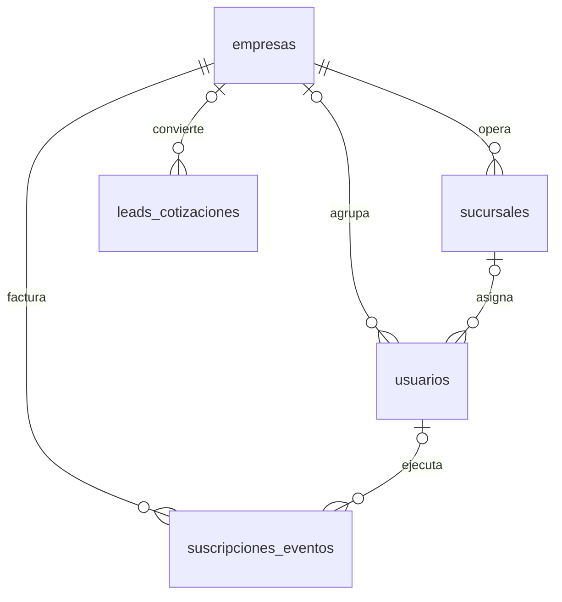
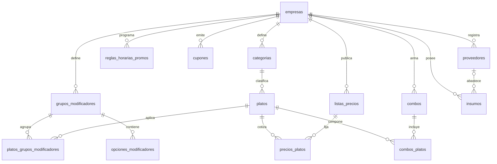
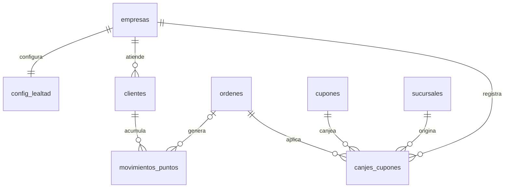
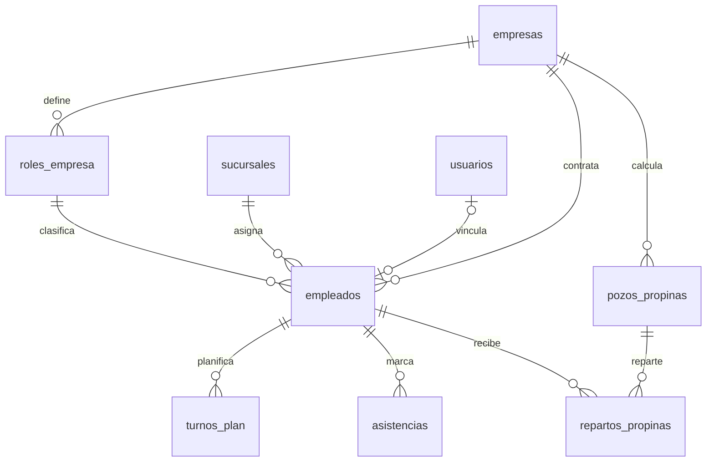
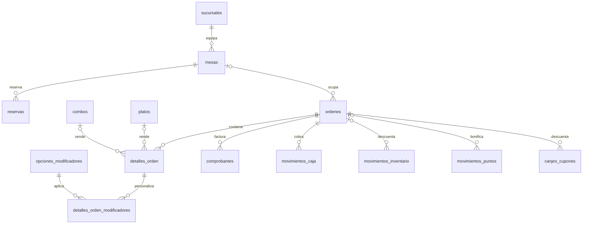
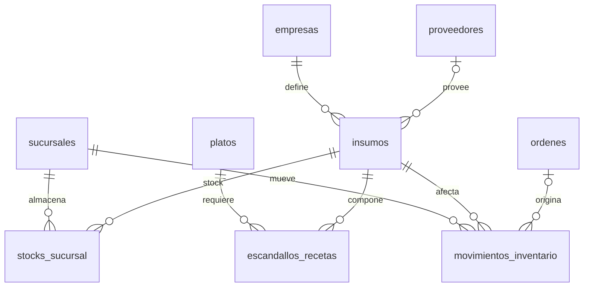
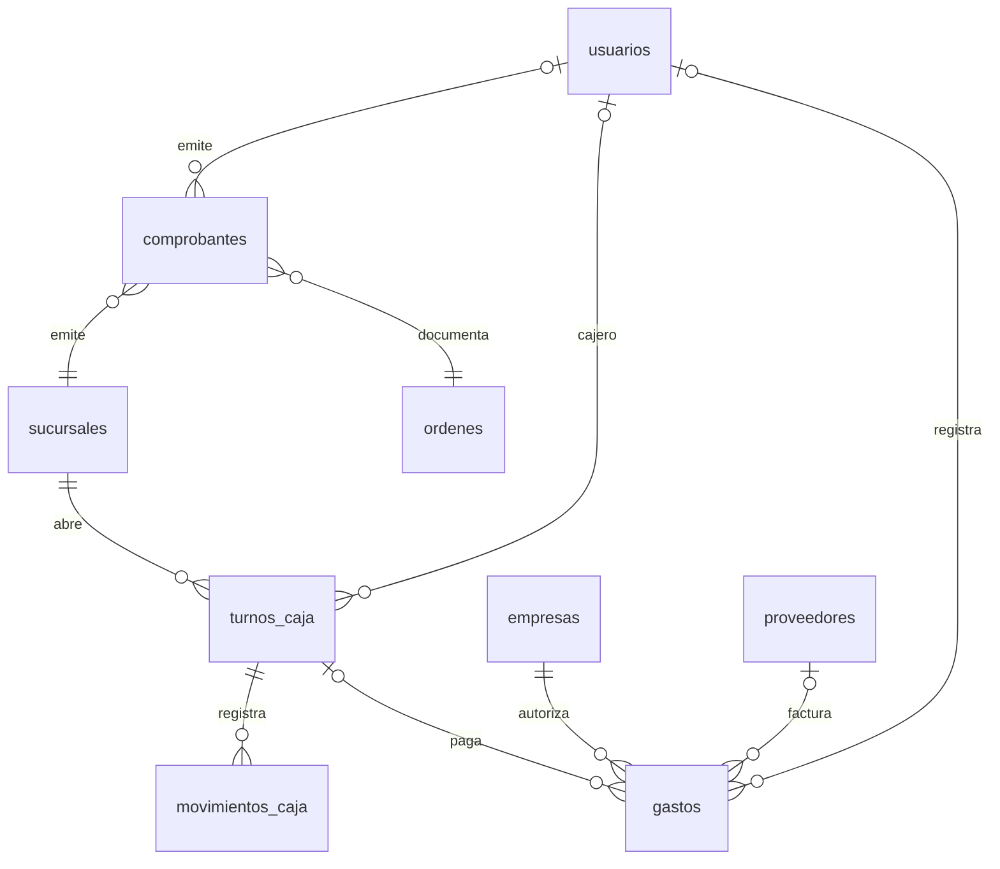
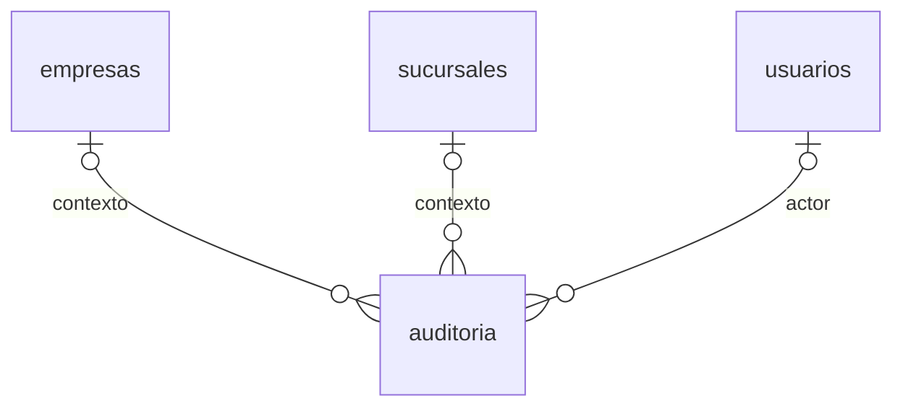

# Modelo de datos — Fogonería System

Modelo físico PostgreSQL 16 del ERP gastronómico multitenant. Esquema `fogoneria`.

- **Fuente ejecutable:** `apps/api/prisma/migrations/**` (la inicial `20261019000000_init` y las cuatro de AYCDS-62)
- **Modelo ORM:** `apps/api/prisma/schema.prisma` (generado con `prisma db pull`)
- **Esquema de referencia:** `db/fogoneria_schema.sql` (DDL + datos demo históricos; no incluye la 62)
- **Alcance:** 41 tablas, 27 enums, 22 triggers `updated_at`, 4 vistas, índices únicos parciales por soft-delete, RLS por tenant

## Convenciones

| Tema | Decisión |
|---|---|
| Esquema | `fogoneria` (sin `@@schema` en Prisma; se usa `?schema=fogoneria`) |
| Claves primarias | `UUID` con `gen_random_uuid()`; tablas puente usan PK compuesta |
| Dinero | `NUMERIC(12,2)`; cantidades de inventario `NUMERIC(12,3)` |
| Fechas | `TIMESTAMPTZ`; fechas calendario `DATE`; horas `TIME` |
| Multi-tenant | `empresa_id` en casi todas las tablas; `sucursal_id` en operación; RLS en `docs/rls-modelo.md` |
| Borrado lógico | `deleted_at`/`deleted_by` en 16 entidades maestras; únicos parciales |
| Inmutabilidad | Triggers contables con SQLSTATE `45000`; catálogo en `docs/errores-db.md` |
| Auditoría | `created_at`/`updated_at`; triggers `set_updated_at()` en 22 tablas |
| Nombres | snake_case en español, tablas en plural |

## Mapa de dominios

| Dominio | Tablas |
|---|---|
| SaaS / tenancy | `empresas`, `sucursales`, `usuarios`, `suscripciones_eventos`, `leads_cotizaciones` |
| Catálogo | `categorias`, `grupos_modificadores`, `opciones_modificadores`, `platos`, `platos_grupos_modificadores`, `listas_precios`, `precios_platos`, `combos`, `combos_platos`, `reglas_horarias_promos`, `cupones`, `proveedores`, `insumos` |
| CRM y fidelidad | `clientes`, `config_lealtad`, `movimientos_puntos`, `canjes_cupones` |
| RRHH | `roles_empresa`, `empleados`, `turnos_plan`, `asistencias`, `pozos_propinas`, `repartos_propinas` |
| Operación | `mesas`, `reservas`, `ordenes`, `detalles_orden`, `detalles_orden_modificadores` |
| Inventario | `stocks_sucursal`, `escandallos_recetas`, `movimientos_inventario` |
| Caja y facturación | `turnos_caja`, `movimientos_caja`, `gastos`, `comprobantes` |
| Auditoría | `auditoria` |

## Diagramas ER por dominio

### SaaS y tenancy



### Catálogo



### CRM y fidelidad



### RRHH



### Operación



### Inventario



### Caja y facturación



### Auditoría



## Catálogo de tablas

| Tabla | Propósito | Claves y relaciones |
|---|---|---|
| `empresas` | Tenant raíz del SaaS; plan, estado y trial | PK `id`; `ruc` único |
| `sucursales` | Locales de una empresa | FK `empresa_id`; único `(empresa_id, nombre)` |
| `usuarios` | Cuentas de acceso con rol global o por sucursal | FK `empresa_id`, `sucursal_id`; email único global si `empresa_id IS NULL` |
| `suscripciones_eventos` | Historial de cambios de plan/estado y MRR | FK `empresa_id`, `actor_usuario_id` |
| `leads_cotizaciones` | Prospectos de la landing | FK `empresa_creada_id`; `rango_sucursales` |
| `categorias` | Categorías de carta | FK `empresa_id`; único `(empresa_id, nombre)` |
| `grupos_modificadores` | Grupos de opciones (tamaño, extras, cocción) | FK `empresa_id`; único `(empresa_id, nombre)` |
| `opciones_modificadores` | Opciones con precio extra | FK `grupo_id`; único `(grupo_id, nombre)` |
| `platos` | Carta maestra por empresa | FK `empresa_id`, `categoria_id`; único `(empresa_id, sku)`; soft delete |
| `platos_grupos_modificadores` | N:M plato ↔ grupo | PK `(plato_id, grupo_id)` |
| `listas_precios` | Carta, delivery, eventos | FK `empresa_id`; único `(empresa_id, nombre)` |
| `precios_platos` | Precio por lista y plato | PK `(lista_id, plato_id)` |
| `combos` | Combos vendibles | FK `empresa_id`; único `(empresa_id, nombre)` |
| `combos_platos` | N:M combo ↔ plato | PK `(combo_id, plato_id)` |
| `reglas_horarias_promos` | Promociones por día y hora | FK `empresa_id`; `dias_semana INT[]`; único `(empresa_id, nombre)` |
| `cupones` | Descuentos con límite y vencimiento | FK `empresa_id`; único `(empresa_id, codigo)` |
| `proveedores` | Proveedores de insumos | FK `empresa_id`; único `(empresa_id, nombre)` |
| `insumos` | Insumos de inventario | FK `empresa_id`, `proveedor_id`; único `(empresa_id, nombre)`; soft delete |
| `clientes` | CRM global por empresa; teléfono = ID de fidelidad | FK `empresa_id`; único `(empresa_id, telefono)` |
| `config_lealtad` | Reglas de puntos y umbrales | PK/FK `empresa_id` |
| `movimientos_puntos` | Ganancia, canje o caducidad de puntos | FK `cliente_id`, `empresa_id`, `sucursal_id`, `orden_id` |
| `canjes_cupones` | Cupón aplicado a una orden | FKs `cupon_id`, `orden_id`, `empresa_id`, `sucursal_id`, `aplicado_por`; único `(cupon_id, orden_id)` |
| `roles_empresa` | Roles operativos configurables | FK `empresa_id`; único `(empresa_id, nombre)` |
| `empleados` | Personal por sucursal | FKs `empresa_id`, `sucursal_id`, `rol_id`, `usuario_id`; usuario único si no es NULL |
| `turnos_plan` | Planificación por bloque | FKs `empresa_id`, `sucursal_id`, `empleado_id`; único `(empleado_id, fecha, bloque)` |
| `asistencias` | Marcaje diario | FKs `empresa_id`, `sucursal_id`, `empleado_id`; único `(empleado_id, fecha)` |
| `pozos_propinas` | Pozo diario por sucursal | FKs `empresa_id`, `sucursal_id`; único `(sucursal_id, fecha)` |
| `repartos_propinas` | Distribución del pozo | PK `(pozo_id, empleado_id)` |
| `mesas` | Mapa de mesas por sucursal | FKs `empresa_id`, `sucursal_id`; único `(sucursal_id, numero)` |
| `reservas` | Reservas con mesa y código | FKs `empresa_id`, `sucursal_id`, `mesa_id`, `creada_por`; único `(empresa_id, codigo)` |
| `ordenes` | Cabecera de pedido/KDS | FKs `empresa_id`, `sucursal_id`, `mesa_id`, `cliente_id`, `mesero_id`, `lista_precio_id`, `cupon_id`; único `(empresa_id, numero_orden)` |
| `detalles_orden` | Líneas de plato o combo | FKs `orden_id`, `plato_id`, `combo_id` |
| `detalles_orden_modificadores` | Opciones elegidas por línea | PK `(detalle_id, opcion_id)` |
| `stocks_sucursal` | Stock actual y mínimo por insumo/sucursal | PK `(sucursal_id, insumo_id)`; FK `empresa_id` |
| `escandallos_recetas` | Consumo de insumo por plato | PK `(plato_id, insumo_id)` |
| `movimientos_inventario` | Kardex de entradas, salidas, ajustes y mermas | FKs `empresa_id`, `sucursal_id`, `insumo_id`, `orden_id`, `actor_id` |
| `turnos_caja` | Apertura/cierre de caja | FKs `empresa_id`, `sucursal_id`, `cajero_id` |
| `movimientos_caja` | Ingresos y egresos del turno | FKs `empresa_id`, `turno_id`, `orden_id`, `gasto_id`, `actor_id` |
| `gastos` | Gastos operativos y su pago | FKs `empresa_id`, `sucursal_id`, `turno_id`, `proveedor_id`, `registrado_por` |
| `comprobantes` | Boleta/factura/ticket por orden | FKs `empresa_id`, `sucursal_id`, `orden_id`, `emitido_por`, `anulado_por`; único `(empresa_id, serie_numero)` |
| `auditoria` | Bitácora de acciones por entidad | FKs opcionales `empresa_id`, `sucursal_id`, `usuario_id`; `detalle JSONB`; `ip INET` |

## Enums

| Enum | Valores |
|---|---|
| `estado_empresa` | `LEAD`, `NO_CALIFICADO`, `TRIAL`, `ACTIVE`, `SUSPENDED`, `EXPIRED` |
| `plan_suscripcion` | `TRIAL`, `BASICO`, `PROFESIONAL` |
| `rango_sucursales` | `1`, `2-3`, `4+` |
| `estado_lead` | `NUEVO`, `CONTACTADO`, `PROPUESTA`, `GANADO`, `DESCARTADO` |
| `rol_usuario` | `SUPERADMIN`, `ADMIN_GLOBAL`, `GERENTE_SUCURSAL`, `COCINERO`, `MESERO`, `CAJERO`, `ANFITRION`, `BARMAN` |
| `estado_usuario` | `ACTIVO`, `INVITADO`, `SUSPENDIDO` |
| `estado_sucursal` | `ABIERTA`, `CERRADA` |
| `origen_orden` | `MESA`, `WEB`, `DELIVERY`, `BARRA` |
| `estado_orden` | `POR_CONFIRMAR`, `EN_COCINA`, `LISTO`, `ENTREGADO`, `ANULADA`, `CERRADA`, `PAGADA` |
| `tipo_detalle_orden` | `PLATO`, `COMBO` |
| `estado_mesa` | `LIBRE`, `OCUPADA`, `RESERVADA`, `MANTENIMIENTO` |
| `forma_mesa` | `REDONDA`, `RECTANGULAR` |
| `estado_reserva` | `POR_CONFIRMAR`, `CONFIRMADA`, `EJECUTADA`, `CANCELADA`, `NO_SHOW` |
| `estado_turno_caja` | `ABIERTO`, `CERRADO` |
| `tipo_movimiento_caja` | `INGRESO`, `EGRESO` |
| `metodo_pago` | `EFECTIVO`, `TARJETA`, `YAPE`, `TRANSFERENCIA` |
| `tipo_comprobante` | `BOLETA`, `FACTURA`, `TICKET` |
| `estado_comprobante` | `PAGADA`, `ANULADA` |
| `categoria_gasto` | `INSUMOS`, `SERVICIOS`, `PERSONAL`, `ALQUILER`, `MARKETING`, `OTROS` |
| `estado_pago_gasto` | `PAGADO`, `PENDIENTE` |
| `tipo_movimiento_inventario` | `ENTRADA`, `SALIDA`, `AJUSTE`, `MERMA` |
| `segmento_cliente` | `NUEVO`, `FRECUENTE`, `VIP` |
| `tipo_movimiento_puntos` | `GANANCIA`, `CANJE`, `CADUCIDAD` |
| `tipo_descuento_cupon` | `PORCENTAJE`, `MONTO` |
| `bloque_turno` | `MANANA`, `TARDE`, `NOCHE`, `DESCANSO` |
| `estado_asistencia` | `PRESENTE`, `TARDANZA`, `FALTA`, `DESCANSO` |
| `estado_pozo_propina` | `CALCULADO`, `REPARTIDO` |

En Prisma, `rango_sucursales` usa miembros `UNO`, `DOS_A_TRES` y `CUATRO_O_MAS` con `@map` a `1`, `2-3` y `4+` porque un enum de Prisma no puede iniciar con número ni contener `+`.

## Vistas BI

| Vista | Contenido |
|---|---|
| `v_ventas_dia` | Órdenes, ventas y ticket promedio por empresa/sucursal/día (excluye `ANULADA`) |
| `v_platos_top` | Cantidad vendida e ingresos por plato |
| `v_ocupacion_mesas` | Mesas totales, ocupadas, libres, reservadas y % de ocupación por sucursal |
| `v_stock_bajo` | Estado de stock por sucursal e insumo: `AGOTADO`, `BAJO`, `OPTIMO` |

## Índices únicos parciales

| Índice | Tabla | Regla |
|---|---|---|
| `uq_usuarios_email_global` | `usuarios` | Email único solo cuando `empresa_id IS NULL` (superadmins) |
| `uq_empleados_usuario` | `empleados` | Un empleado por usuario solo cuando `usuario_id IS NOT NULL` |

## Triggers y funciones

- `set_updated_at()` actualiza `NEW.updated_at = now()`.
- 22 triggers `trg_*_updated_at` cubren las tablas con columna `updated_at`.
- Las vistas y triggers no son modelados por Prisma: viven en la migración SQL y deben preservarse al crear nuevas migraciones con `prisma migrate dev --create-only`.
- AYCDS-62 agrega `soft_delete_row()`, `restore_row()`, `raise_immutable()`, las funciones de contexto (`current_empresa_id()`, `current_sucursal_id()`, `current_usuario_id()`, `is_bypass()`) y los triggers de inmutabilidad contable.

## Índices de AYCDS-62

Compuestos por tenant y orden temporal; el detalle está en `docs/rls-modelo.md`.

| Tabla | Índice | Columnas |
|---|---|---|
| `ordenes` | `idx_ordenes_tenant_sucursal_estado` | `(empresa_id, sucursal_id, estado, created_at DESC)` |
| `ordenes` | `idx_ordenes_tenant_fecha` | `(empresa_id, created_at DESC)` |
| `turnos_caja` | `idx_turnos_tenant_sucursal_estado` | `(empresa_id, sucursal_id, estado)` |
| `turnos_caja` | `idx_turnos_tenant_fecha` | `(empresa_id, apertura_at DESC)` |
| `movimientos_caja` | `idx_movcaja_tenant_fecha` | `(empresa_id, created_at DESC)` |
| `movimientos_caja` | `idx_movcaja_turno_fecha` | `(turno_id, created_at)` |
| `gastos` | `idx_gastos_tenant_fecha` | `(empresa_id, sucursal_id, created_at DESC)` |
| `comprobantes` | `idx_comp_tenant_fecha` | `(empresa_id, sucursal_id, created_at DESC)` |
| `comprobantes` | `idx_comp_tenant_estado` | `(empresa_id, estado, created_at DESC)` |
| `movimientos_inventario` | `idx_movinv_tenant_insumo_fecha` | `(empresa_id, sucursal_id, insumo_id, created_at DESC)` |
| `reservas` | `idx_reservas_sucursal_fecha` | `(sucursal_id, fecha_hora)` |
| `reservas` | `idx_reservas_tenant_estado` | `(empresa_id, estado, fecha_hora)` |
| `asistencias` | `idx_asis_tenant_fecha` | `(empresa_id, sucursal_id, fecha DESC)` |
| `turnos_plan` | `idx_tp_sucursal_fecha` | `(sucursal_id, fecha)` |
| `platos` | `idx_platos_tenant_categoria_activo` | `(empresa_id, categoria_id, activo)` WHERE `deleted_at IS NULL` |
| `clientes` | `idx_clientes_tenant_visitas` | `(empresa_id, visitas DESC)` |
| `movimientos_puntos` | `idx_movpuntos_tenant_fecha` | `(empresa_id, created_at DESC)` |
| `usuarios` | `idx_usuarios_email` | `(email)` |
| `usuarios` | `idx_usuarios_tenant_estado` | `(empresa_id, estado)` |
| `auditoria` | `idx_aud_tenant_fecha` | `(empresa_id, created_at DESC)` |
| `auditoria` | `idx_aud_entidad_fecha` | `(entidad, entidad_id, created_at DESC)` |

## Baja lógica (AYCDS-62)

Entidades con `deleted_at`/`deleted_by`: `empresas`, `sucursales`, `usuarios`,
`categorias`, `grupos_modificadores`, `platos`, `listas_precios`, `combos`,
`reglas_horarias_promos`, `cupones`, `proveedores`, `insumos`, `clientes`,
`roles_empresa`, `empleados`, `mesas`.

Los únicos de negocio pasan a índices parciales `WHERE deleted_at IS NULL`:
`uq_sucursales_empresa_nombre`, `uq_usuarios_empresa_email`,
`uq_categorias_empresa_nombre`, `uq_grupos_empresa_nombre`,
`uq_platos_empresa_sku`, `uq_listas_empresa_nombre`, `uq_combos_empresa_nombre`,
`uq_reglas_empresa_nombre`, `uq_cupones_empresa_codigo`,
`uq_proveedores_empresa_nombre`, `uq_insumos_empresa_nombre`,
`uq_clientes_empresa_tel`, `uq_roles_empresa_nombre`, `uq_mesas_sucursal_numero`.

## Uso con Prisma

```bash
pnpm --filter api db:deploy
pnpm --filter api db:seed
pnpm --filter api db:studio
```

El cliente se genera en `apps/api/src/generated/prisma` y no se versiona. `DATABASE_URL` debe incluir `?schema=fogoneria`; el adaptador `PrismaPg` recibe además `{ schema: "fogoneria" }`.
